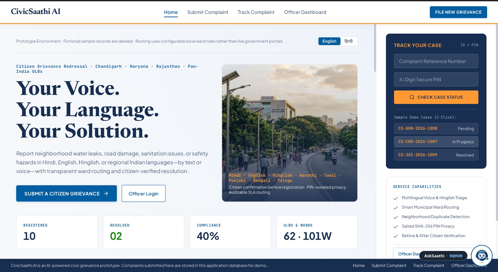
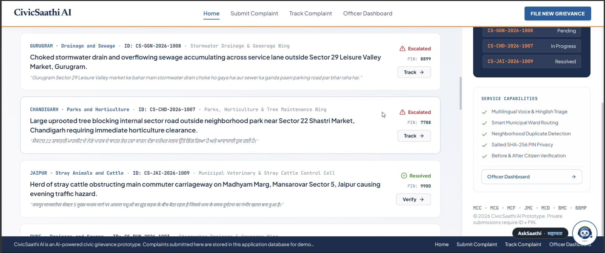
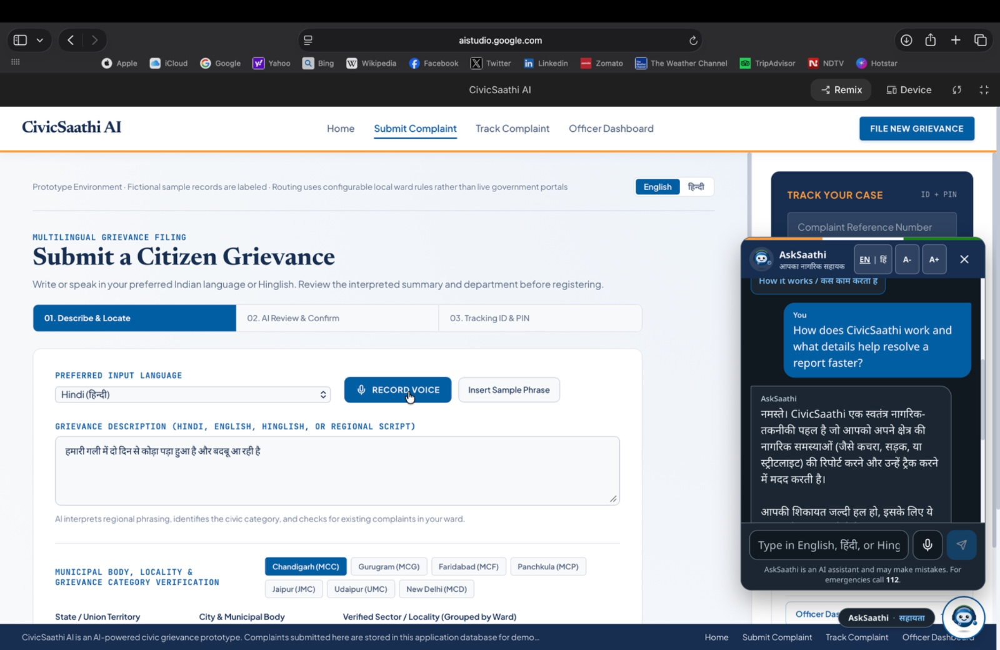
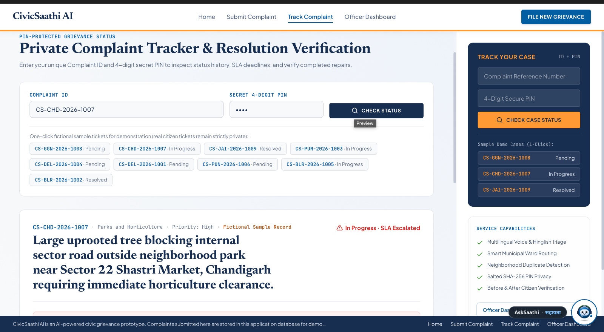
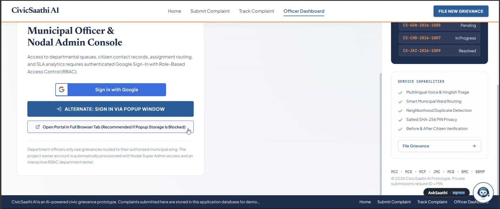
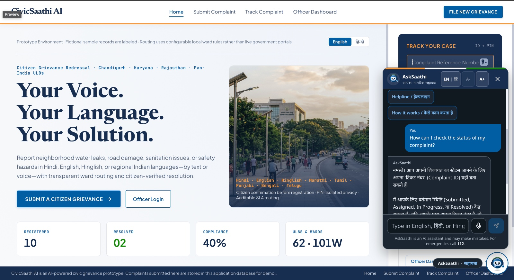

# CivicSaathi AI (नागरिक साथी AI)

**Your Voice. Your Language. Your Solution.**

AI-powered multilingual civic grievance redressal for Indian cities.

---

## Table of Contents

1. [About the Project](#about-the-project)
2. [Key Features](#key-features)
3. [Screenshots](#screenshots)
4. [How It Works](#how-it-works)
5. [Supported Cities and Languages](#supported-cities-and-languages)
6. [Installation and Setup](#installation-and-setup)
7. [How to Use the App](#how-to-use-the-app)
8. [Privacy and Security](#privacy-and-security)
9. [Disclaimer](#disclaimer)

---

## About the Project

Reporting a civic issue in India is still hard. Citizens face four problems:

- **Language barrier:** most portals expect English or formal Hindi.
- **Unclear routing:** people do not know which body, ward or department owns the issue.
- **Duplicate reports:** the same problem is filed again and again.
- **No proof of repair:** complaints are closed without citizen verification.

**CivicSaathi AI** solves these with one platform. A citizen describes the problem in their own language, by text or voice. The AI understands it, detects the category, and routes it to the correct municipal body and ward. The citizen then tracks it with a private Complaint ID and PIN, and verifies the repair.

## Key Features

| Feature | What it does |
| :--- | :--- |
| Multilingual input | Hindi, Hinglish, English, Marathi, Punjabi, Tamil, Bengali and Telugu |
| Voice and text | Record your voice or type the complaint |
| AI category triage | Auto-detects the category from 12 verified civic categories |
| Smart ward routing | Confirms the municipal body, ward, sector and civic helpline |
| Duplicate detection | Groups similar complaints in the same neighbourhood |
| Public complaint feed | Shows status: Pending, In Progress, Escalated, Resolved |
| Private tracking | Complaint ID plus 4-digit PIN, with SLA deadlines |
| Citizen verification | Verify the repair after resolution (before and after check) |
| Officer console | Google Sign-In, role-based access, department queues, SLA analytics |
| AskSaathi assistant | AI chat helper in English, Hindi and Hinglish |
| Accessibility | English/हिन्दी toggle and adjustable text size |

## Screenshots

### 1. Home Page

Clear entry point with live counters (registered, resolved, compliance, ULBs and wards).



### 2. Public Complaint Feed

Every complaint shows its department, ID and status. Duplicates are grouped, and resolved cases have a **Verify** button.



### 3. File a Complaint and Smart Ward Routing

Choose a language, describe the issue, then select the city and sector. The app verifies the municipal authority, ward and helpline.



### 4. Private Complaint Tracker

Enter the Complaint ID and secret PIN to see status history, SLA deadlines and repair verification.



### 5. Officer and Admin Console

Authenticated access for municipal officers with role-based access control.



### 6. AskSaathi AI Assistant

Quick actions for reporting, checking status, finding the nearest office and the helpline.



## How It Works

```text
Citizen describes issue (voice or text, in any of 8 languages)
      |
      v
Step 1: Describe & Locate   -> language, city, municipal body, sector, optional photo
      |
      v
Step 2: AI Review & Confirm -> category detected, department and ward previewed
      |
      v
Step 3: Tracking ID & PIN   -> complaint registered, ID and 4-digit PIN issued
      |
      v
Officer console             -> queue, assignment, SLA tracking
      |
      v
Citizen verifies the repair -> complaint closed
```

## Supported Cities and Languages

**Cities (7):** Chandigarh (MCC), Gurugram (MCG), Faridabad (MCF), Panchkula (MCP), Jaipur (JMC), Udaipur (UMC), New Delhi (MCD)

**Languages (8):** Hindi, Hinglish, English, Marathi, Punjabi, Tamil, Bengali, Telugu

**Categories (12):** Water, Drainage/Sewage, Roads, Sanitation, Streetlights, Electricity, Parks and Trees, Encroachment, Stray Animals/Cattle, Fogging/Health, Safety, General

## Installation and Setup

### Prerequisites

- [Node.js](https://nodejs.org/) version 18 or higher (check with `node -v`)
- npm (comes with Node.js)
- A free **Gemini API key** from [Google AI Studio](https://aistudio.google.com/apikey)

### Step 1: Get the code

```bash
git clone https://github.com/<your-username>/<your-repo-name>.git
cd <your-repo-name>
```

> Replace `<your-username>` and `<your-repo-name>` with your own GitHub details.

### Step 2: Install dependencies

```bash
npm install
```

### Step 3: Add your API key

Create a file named `.env.local` in the project root folder and add:

```env
GEMINI_API_KEY=your_api_key_here
```

If your project also uses Google Sign-In or a database for the officer console, add those keys to the same file.

> Never commit `.env.local` to GitHub. Make sure it is listed in `.gitignore`.

### Step 4: Run the app

```bash
npm run dev
```

Open the local address shown in the terminal (usually `http://localhost:3000` or `http://localhost:5173`).

### Step 5: Build for production (optional)

```bash
npm run build
npm run preview
```

### Troubleshooting

| Problem | Fix |
| :--- | :--- |
| "Unable to connect to AskSaathi" | Check that `GEMINI_API_KEY` is set correctly, then restart the dev server |
| `npm install` fails | Update Node.js to version 18 or higher and try again |
| Voice recording does not work | Allow microphone access in the browser. Use Chrome or Edge |
| Port already in use | Stop the other app, or run on another port |

## How to Use the App

### As a citizen

1. Open the home page and click **Submit a Citizen Grievance**.
2. Pick your language and describe the problem by typing or clicking **Record Voice**. You can also click **Insert Sample Phrase** to try it.
3. Select your city, municipal body and sector. Check the verified ward and helpline.
4. Leave the category on **Auto-detect via AI Triage**, or choose one. Optionally attach a street photo.
5. Click **Analyze & Preview Department Routing**, review the AI summary and confirm.
6. Save your **Complaint ID** and **4-digit PIN**.
7. Open **Track Complaint**, enter both, and click **Check Status**.
8. When the issue is fixed, verify the repair.

### As a municipal officer

1. Open **Officer Dashboard**.
2. Sign in with Google.
3. Manage your department queue and monitor SLA analytics.

**Try the demo tickets:** on the tracking page, click any sample ticket such as `CS-CHD-2026-1007` (In Progress) or `CS-JAI-2026-1009` (Resolved).

## Privacy and Security

- Complaint details are private. Tracking needs both the Complaint ID and the secret PIN.
- PINs are protected with salted SHA-256 hashing.
- Officer access uses Google Sign-In with role-based access control.
- In an emergency, call **112**.

## Disclaimer

CivicSaathi AI is a prototype built for a hackathon. Complaints submitted here are stored in the app database for demonstration purposes only. Sample records are fictional, and routing uses configurable local ward rules, not live government portals.

---

**This Project Is Made by the Use Of Google AI Studio**
